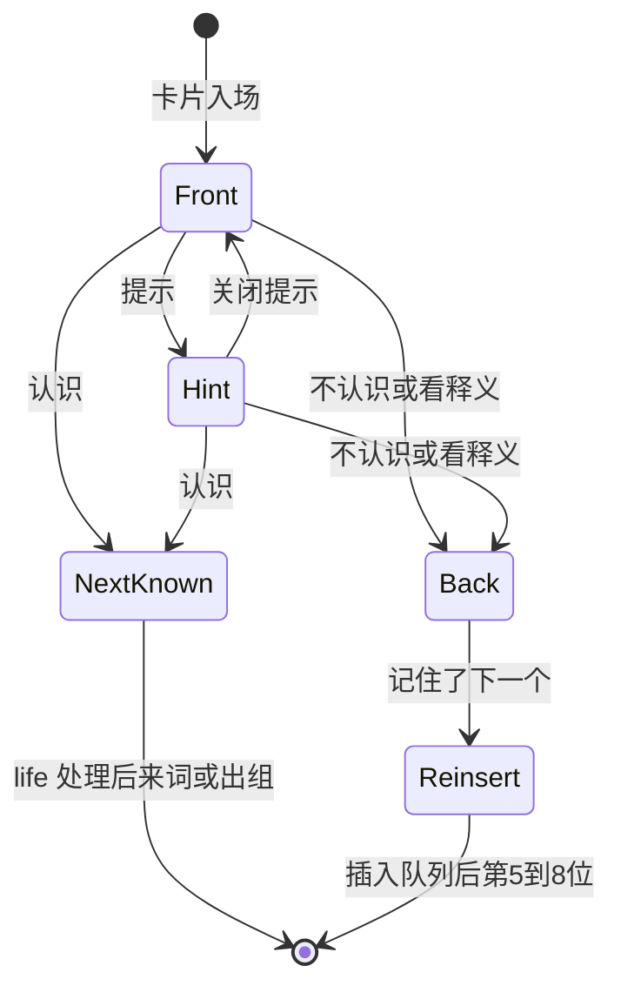
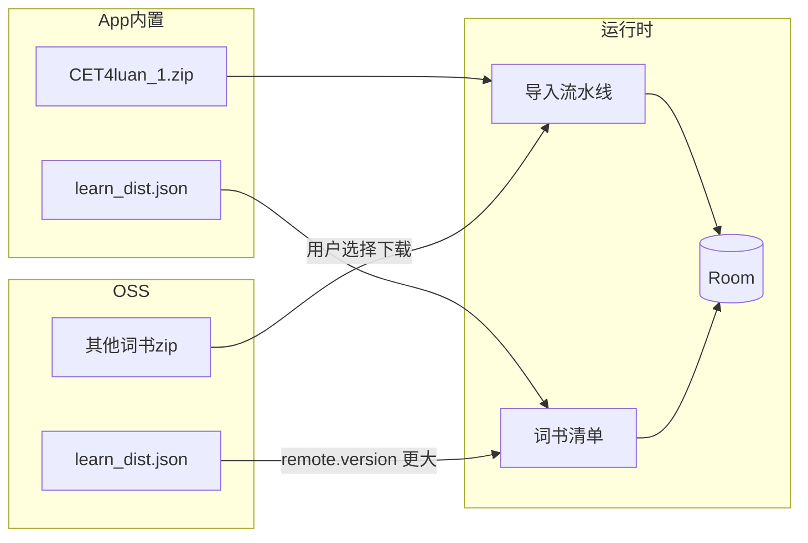
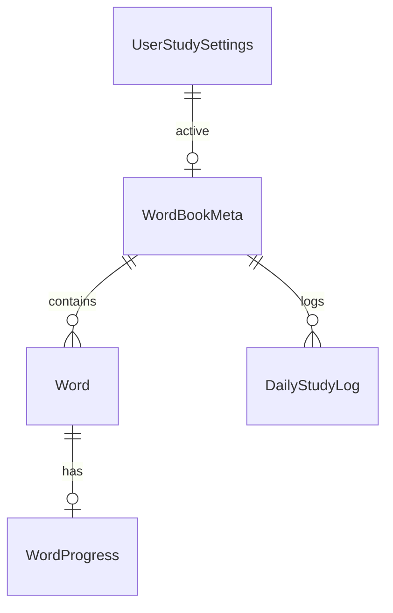
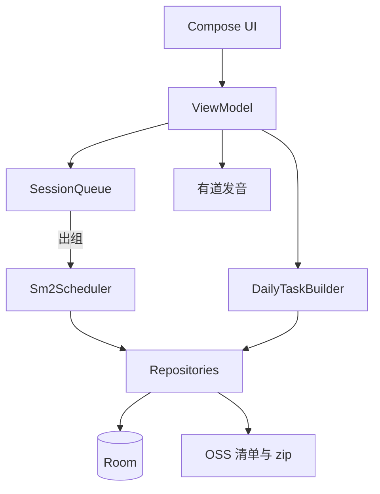

# 记单词 PRD


| 项   | 内容                                                                                                                             |
| --- | ------------------------------------------------------------------------------------------------------------------------------ |
| 产品  | Linsia · 记单词                                                                                                                   |
| 状态  | 草案                                                                                                                             |
| 范围  | 完整愿景 + MVP 边界；实现另开阶段                                                                                                           |
| 平台  | Android / iOS / Desktop（KMP Compose）                                                                                           |
| 上游  | [doc/learn_word.md](../learn_word.md)、[doc/arch.md](../arch.md)、[dist/world/learn_dist.json](../../dist/world/learn_dist.json) |


本文描述**做什么、做成什么样**。不规定类名、任务拆分或排期。研发按全文理解愿景，**首版只交付第 11 节标注为 MVP 的能力**。

优先级：

- **Must**：MVP 必须交付
- **Should**：完整愿景应有，可放到 V1.1+
- **Won’t**：本产品明确不做（当前周期）

---

## 1. 背景与目标

Linsia 取山海灵川潮汐之意：学识如潮水源源不断，积微成博。记单词是首个业务功能，服务英语学习者（四六级、考研、雅思托福 GRE、中高考）。

**体验目标**

1. 背词时心流不被打断。
2. 用最少点击完成一次判断。
3. 认识的词快速划掉，不认识的词在当次会话内反复出现，直到连续认出。
4. 无网也能背内置四级词书；进度不丢。

**成功标准（产品）**

- 用户能在首次安装后、无需联网，开始背「四级真题核心词」。
- 用户完成今日词包后，能看到即时战报，而不是被直接弹回首页。
- 跨天打开 App，到期复习词按 SM-2 出现。

Slogan（品牌，非界面硬编码要求）：学如潮汐 · 积微成博。

视觉：活力多巴胺暖色（珊瑚粉 / 暖橙 / 阳光黄），年轻、娱乐向。

---

## 2. 术语表


| 术语            | 定义                                                          |
| ------------- | ----------------------------------------------------------- |
| 词书            | 一本可下载/内置的词汇集合，对应清单中的 `name`（如 `CET4luan_1`）                 |
| 词库清单          | `learn_dist.json`：`version` + `reops[]`（title / name / url） |
| 今日词包          | 当天要过的词列表，由新词与复习词混合而成                                        |
| X             | 用户设定的每日新词数                                                  |
| Y             | 今日到期复习词数（`nextReviewAt ≤ 今天`）                               |
| Z             | 昨日词包中未完成（未出组）的遗留词数                                          |
| N             | 今日总任务：`N = X + Y + Z`                                       |
| Session       | 一次连续背词会话（从点「开始」到词包出组完毕或用户中途退出）                              |
| Session Queue | 会话内存队列，负责错词短间隔重现                                            |
| life          | 会话内生命值。新词/错词初始为 2，连续「认识」扣减，到 0 才出组                          |
| 出组            | 该词完成今日学习，才允许写入长期 SM-2 的 `nextReviewAt`                      |
| SM-2          | Anki 同款间隔重复算法，调度跨天复习                                        |
| quality       | 本次回忆质量，映射到「认识 / 不认识」                                        |
| Mastered      | 已掌握：复习间隔大于约定天数（见 4.5）                                       |
| 内置词书          | 随 App 打包的 `CET4luan_1`，开箱可背                                 |
| 远程清单          | OSS 上的 `learn_dist.json`，用 `version` 与本地比较                  |


---

## 3. 用户故事

### 3.1 MVP


| ID    | 作为   | 我想要                          | 以便       |
| ----- | ---- | ---------------------------- | -------- |
| US-1  | 新用户  | 安装后立刻看到词书首页，并开始背四级词          | 无网也能体验   |
| US-2  | 学习者  | 选择当前词书，看到是否已导入 / 需下载         | 知道从哪本书背  |
| US-3  | 学习者  | 下载非内置词书并导入后开始背               | 换书学习     |
| US-4  | 学习者  | 每天打开得到今日词包（新词 + 到期复习 + 昨日遗留） | 任务量可预期   |
| US-5  | 学习者  | 看英文形+音，点「认识」立刻下一张            | 快过认识的词   |
| US-6  | 学习者  | 点「不认识」看到释义，该词稍后再次出现          | 当次真正记住   |
| US-7  | 学习者  | 杀进程再打开，进度还在                  | 不怕中断     |
| US-8  | 学习者  | 背完看到词数、用时、正确率、连续打卡天数         | 有即时反馈    |
| US-9  | 学习者  | 设置每日新词数、英音/美音                | 匹配自己的节奏  |
| US-10 | 联网用户 | App 发现更高版本清单并更新词书列表          | 后续加书不用发版 |


### 3.2 V1.1+


| ID    | 作为              | 我想要               | 以便                |
| ----- | --------------- | ----------------- | ----------------- |
| US-11 | 学习者             | 左右滑卡片、上滑看提示       | 盲操、少点按钮           |
| US-12 | Desktop/iPad 用户 | 用键盘完成背词           | 不碰鼠标              |
| US-13 | 学习者             | 看打卡热力图、掌握分布、周时长折线 | 看见长期进步            |
| US-14 | 学习者             | 生成分享卡片            | 社交打卡              |
| US-15 | 多端用户            | 进度云同步             | 换设备接着背            |
| US-16 | 断签用户            | 补签                | 保住 streak（商业化可选项） |


---

## 4. 功能需求

学习流程固定为三阶段：**任务生成 → 背诵交互 → 结算反馈**。不得在词包未结束时直接回到首页且无任何结算（用户主动退出除外，见 4.4）。

### 4.1 词书首页

**Must**

- 展示当前词书标题、导入状态、今日任务入口（开始 / 继续）。
- 展示连续打卡天数（Streak）。
- 提供进入词书选择、学习设置的入口。
- 今日词包尚未生成时，进入学习前按 4.2 生成；已生成未完成则继续 Session（不得重复抽取一整包新词）。

**Should**

- 首页展示今日预估词数 N、明日预估复习数。

### 4.2 每日任务生成

**Must**

输入：当前 `activeBookId`、设置中的 X、本地日期 `today`、该词书进度表。

输出：今日词包 `StudySession`，长度 N。

规则：

```
N = X + Y + Z
Y = 状态为学习中/巩固中/已掌握，且 nextReviewAt ≤ today 的词
Z = 昨日词包中未出组的词（去重后计入，不再额外抽新词顶替）
新词 = 从 status = New 的词中按词书顺序取 X 个；不足则少取，不得跨词书补词
```

出词顺序（穿插）：

1. 前段偏复习词（建立熟练感）。
2. 中段引入新词。
3. 后段新词与旧词混排。
4. 同一词在初始词包中只出现一次；会话内重现由 Session Queue 负责，不在生成阶段重复塞入。

边界：

- 词书未导入：不得生成词包，引导导入/使用内置书。
- `X = 0` 且 `Y + Z = 0`：展示「今日无任务」，可提供「再学一批」作为显式加练（加练仍走 Session，但不强制记为打卡，除非完成设定任务）。
- 时区：以设备本地日历日为准。

### 4.3 背诵交互

目标：最短时间划掉认识的词，集中精力处理不认识的词。

#### 4.3.1 卡片状态机




| 状态   | 视觉                              | 行为                          |
| ---- | ------------------------------- | --------------------------- |
| A 正面 | 大字号英文、音标；无中文                    | 入场自动播放发音；给 1～2 秒思考时间（不阻塞操作） |
| B 提示 | 挖空例句和/或词性                       | 再播发音；不展示完整中文释义              |
| C 背面 | 3D 翻转；中文释义按词性分行；例句、助记/词根若数据有则展示 | 底部改为单一主按钮「记住了，下一个」          |


**Must（MVP）**

- 状态 A、C。
- 正面两个动作：认识、不认识（按钮即可）。
- 不认识 → 进入背面；背面主按钮 → 该词按错词规则重插入列（见 4.4）。
- 认识（在正面）→ 按 life 规则处理，切下一词，无等待网络。
- 卡片入场自动发音；可再次点击喇叭重播。

**Should（V1.1+）**

- 状态 B（提示层）。
- 背面后的「强制考核」（拼写或选义）——愿景漏斗第 3 步；MVP **Won’t**，避免拉长单次操作。

#### 4.3.2 认识 / 不认识 的数据含义


| 用户动作           | quality（建议） | Session                            | 长期 SM-2               |
| -------------- | ----------- | ---------------------------------- | --------------------- |
| 正面点认识          | ≥ 4         | `life - 1`；life 到 0 则出组            | **仅出组时**按「回忆成功」更新     |
| 不认识 → 背面 → 记住了 | ≤ 2         | life 保持（若尚未设则视为错词 life=2）；重插 5～8 位 | 不出组，不改 `nextReviewAt` |
| 新词首次进入 Session | —           | life 初始 = 2                        | 未出组前不写间隔              |


说明：愿景中「复习词点认识直接出组」与「新词需要连续认出」并存。统一规则：**凡进入 Session 的词初始 life=2**（含复习词）。若产品后续要区分「复习词一次认识即出组」，作为可配置项，默认仍为 2。

#### 4.3.3 手势与快捷键

**Should**

- 右滑 / 右侧大按钮：认识
- 左滑 / 左侧大按钮：不认识（翻面）
- 上滑 / 点卡片空白：提示（状态 B）

**Should（Desktop / 大屏）**


| 键     | 动作        |
| ----- | --------- |
| Space | 播放 / 重播发音 |
| → 或 J | 认识        |
| ← 或 F | 不认识       |
| ↓     | 看释义 / 翻面  |


MVP **Won’t** 强制手势与快捷键；有按钮即可。

### 4.4 Session Queue

**Must**

- 会话期间维护内存队列；错词不得直接丢到「明天」。
- 重插入位置：当前剩余队列后方第 **5～8** 位（随机闭区间）；若剩余不足 5，则插到队尾。
- 出组条件：该词在**本 Session** 中连续「认识」使 life 降到 0。
- 出组瞬间才允许调用 SM-2，写入 `nextReviewAt`、`interval`、`easeFactor`、`repetitions`。
- 用户中途退出：未出组词记入 Z（次日遗留）；已出组进度必须已落盘。
- 答题反馈不得阻塞 UI：先动画与队列更新，进度写入本地；不得等待远端接口。

**Should**

- 错词再次出现时有「再认」视觉标记。
- life 清零时有出组动效。

### 4.5 SM-2（跨天）

**Must**

仅对**出组**事件执行。输入：该词当前 `easeFactor`、`interval`、`repetitions`、本次 quality。输出：新的三元组 + `nextReviewAt = today + interval`（interval 单位：天，至少 1）。

约定（与 Anki SM-2 对齐的最小契约）：

- 默认 `easeFactor = 2.5`，下限 1.3。
- quality ≥ 4（认识出组）：`repetitions` 增加；`interval` 按 SM-2 递推；`easeFactor` 略增。
- quality ≤ 2（若未来支持「出组时仍失败」）：`repetitions` 归零，`interval` 回到 1。
- MVP 路径：只有正面连续认识导致出组，故出组时 quality 按成功处理。背面重插路径不出组。

词条长期状态（统计用，可从 interval 推导）：


| 梯队      | 规则                  |
| ------- | ------------------- |
| 未开始     | 从未进入过 Session       |
| 生词（学习中） | 已见，`interval < 3` 天 |
| 熟词（巩固中） | `3 ≤ interval ≤ 15` |
| 已掌握     | `interval > 15`     |


总掌握词汇量：该词书中「已掌握」的词数。若与「interval > 30」双标准冲突，**以 interval > 15 为准**，30 天可作为后续更严档。

### 4.6 结算

**Must**

词包全部出组后进入结算页，禁止无反馈地回到首页。

结算至少展示：

- 今日斩获词数（出组数）
- 用时（背词页前台活跃秒数，见 4.7）
- 正确率：首轮即认识的词数 / 今日过词次数（含重现）
- 连续打卡天数
- 明日预计复习数（Should，有则更好；MVP 可省略）

**Should**

- 新学 / 复习比例图
- 打卡日历
- 分享卡片（金句 + App 入口）

用户主动退出未完成词包：**Should** 给简短确认；**Must** 保存进度；可不进入完整结算，首页用「继续」恢复。

### 4.7 统计指标

**Must**


| 指标          | 定义                                               |
| ----------- | ------------------------------------------------ |
| Streak      | 连续完成「当日设定任务」的天数；当日 N 全部出组则 +1；未完成不中断历史展示，但当日不 +1 |
| 今日学习时长      | 背词界面在前台且判定为活跃的秒数累加（锁屏/切到后台暂停）                    |
| 正确率         | 见 4.6                                            |
| 今日新学 / 今日复习 | 出组词中来源为新词或复习/遗留的计数                               |


**Should**

- 打卡热力图；点某日看当日词与时长
- 四梯队分布图
- 近 7 日时长折线 + 日均基准线
- 补签（改某日汇总）——商业能力，默认不做

### 4.8 学习设置

**Must**

- 每日新词数 X（建议默认 20，允许合理上下限，如 5～100）
- 发音：英音 `type=1` / 美音 `type=2`
- 当前词书 `activeBookId`

**Should**

- 复习词是否「一次认识即出组」

---

## 5. 词库与更新

数据源：有道词书结构（[kajweb/dict](https://github.com/kajweb/dict)）；发音：[有道 dictvoice](https://dict.youdao.com/dictvoice?audio={word}&type={1|2})。ECDICT 作为释义补全的后续可选源，MVP **Won’t** 依赖。

### 5.1 清单格式

与 [dist/world/learn_dist.json](../../dist/world/learn_dist.json) 一致：

```json
{
  "version": 10,
  "reops": [
    {
      "title": "四级真题核心词",
      "name": "CET4luan_1",
      "url": "https://…/CET4luan_1.zip"
    }
  ]
}
```

**Must**

- 解析时只认 `url` 为下载地址。若历史数据出现 `file` 字段，导入层须归一到 `url`（`url` 优先，否则用 `file`）。
- `name` 全局唯一，作为词书 ID 与 OSS object key。
- 当前内置清单版本以仓库中该文件的 `version` 为准（现为 10），含 13 本词书。

内置词书列表（产品目录）：


| name           | title             |
| -------------- | ----------------- |
| CET4luan_1     | 四级真题核心词（**随包内置**） |
| CET6luan_1     | 六级真题核心词           |
| KaoYanluan_1   | 考研必考词汇            |
| Level4luan_1   | 专四真题高频词           |
| Level8luan_1   | 专八真题高频词           |
| CET4luan_2     | 四级英语词汇            |
| CET6luan_2     | 六级英语词汇            |
| KaoYanluan_2   | 考研英语词汇            |
| IELTSluan_2    | 雅思词汇              |
| TOEFLluan_2    | 托福词汇              |
| GREluan_2      | GRE词汇             |
| ChuZhongluan_2 | 中考必备词汇            |
| GaoZhongluan_2 | 高考必备词汇            |


### 5.2 交付策略

**Must**

- App **内置**词库清单（打包 `learn_dist.json`）。
- App **内置**一本词书 zip：`CET4luan_1`（四级真题核心词）。首次使用该词书时从包内导入 Room，不依赖网络。
- 非内置词书：用户选择后按条目 `url` 下载 zip，解压导入 Room；导入成功后可删除 zip 缓存。
- 同一 `name` 已导入则不得重复全量插入；若远程词书有内容版本概念，后续用内容版本号决定是否重建（MVP：已导入则跳过，除非用户手动「重新导入」）。




### 5.3 清单 OSS 更新

**Must**

- 远程清单 URL：与 OSS 词书同一 bucket，对象 key 为 `learn_dist.json`（即 `{S3_ENDPOINT}/{bucket}/learn_dist.json`）。具体 host 以发布环境配置为准，不得把密钥打进客户端。
- 比较规则：仅当 `remote.version > local.version` 时，用远程文件覆盖本地持久化清单；`local.version` 初始等于内置文件的 `version`。
- 相等或更小：不覆盖。
- 更新失败：保留本地清单，可提示稍后重试；不影响已导入词书背词。
- 触发：冷启动检查 **Should**；设置页「检查词书更新」**Must**。

**Won’t（MVP）**

- 清单更新不自动下载全部词书。
- 不因清单更新删除用户已有进度。新增的 `name` 出现在列表中即可。

### 5.4 词书内容结构（导入契约）

Zip 内为有道词书 JSON（常见字段：`headWord`、`bookId`、`content.word` 下的音标 `ukphone`/`usphone`、`trans[]`、例句/短语/同根等）。

**Must**

- 导入后 Room 中每词可支撑正面（词形、音标）与背面（词性+中释；有则展示例句）。
- 缺失音标/例句时降级：仍可背，不崩溃。
- `bookId` 与清单 `name` 不一致时，以清单 `name` 作为进度外键，内容 `bookId` 仅作元数据。

---

## 6. 数据模型

进度与词条以 **Room 为唯一运行时源**。云端同步见第 8 节，MVP 不写远端。

### 6.1 逻辑实体

#### WordCatalog（清单，可文件 + 表缓存）


| 字段        | 说明                 |
| --------- | ------------------ |
| version   | Int，清单版本           |
| updatedAt | 最近一次成功应用远程清单的时间，可空 |


#### WordBookMeta


| 字段         | 说明         |
| ---------- | ---------- |
| name       | PK，词书 ID   |
| title      | 展示名        |
| url        | 下载地址       |
| bundled    | 是否内置 zip   |
| imported   | 是否已导入 Room |
| importedAt | 导入时间       |


#### Word


| 字段                | 说明           |
| ----------------- | ------------ |
| id                | PK           |
| bookId            | 清单 name      |
| headWord          | 词形           |
| ukPhone / usPhone | 音标，可空        |
| transJson         | 词性+中释（及英释若有） |
| sentenceJson      | 例句，可空        |
| extraJson         | 短语/词根/助记等，可空 |
| ordinal           | 词书内顺序，抽新词用   |


#### WordProgress


| 字段              | 说明                                                  |
| --------------- | --------------------------------------------------- |
| bookId + wordId | PK                                                  |
| status          | New / Learning / Review / Mastered（或只存 interval 推导） |
| easeFactor      | 默认 2.5                                              |
| intervalDays    | 间隔天数                                                |
| repetitions     | 成功出组次数                                              |
| nextReviewAt    | 日期或 Instant                                         |
| lastReviewAt    | 最近出组时间                                              |
| lifeSnapshot    | 可选：中途退出时未出组 life，供 Z 恢复                             |


#### UserStudySettings


| 字段            | 说明      |
| ------------- | ------- |
| dailyNewWords | X       |
| activeBookId  | 当前词书    |
| accent        | UK / US |


#### DailyStudyLog


| 字段               | 说明                            |
| ---------------- | ----------------------------- |
| date             | 本地日                           |
| bookId           | 可选，按书或按日汇总需在实现时定一种；MVP 按日+当前书 |
| newGraduated     | 今日新词出组数                       |
| reviewGraduated  | 今日复习/遗留出组数                    |
| durationSec      | 活跃秒数                          |
| firstPassCorrect | 首轮认识数                         |
| totalEncounters  | 过词次数（含重现）                     |
| taskCompleted    | 是否完成当日 N                      |


#### PendingAnswer（无感上报队列）


| 字段         | 说明                                 |
| ---------- | ---------------------------------- |
| sessionId  | 会话                                 |
| wordId     | 词                                  |
| quality    | 映射后的质量                             |
| answeredAt | 时间                                 |
| flushed    | 是否已应用到 Progress；MVP 可会话结束一次性 flush |


### 6.2 关系




词条静态数据与进度分离：删词书内容不得在无确认时抹掉 Progress；重新导入以 `bookId+headWord` 对齐进度。

---

## 7. 架构

对齐 [doc/arch.md](../arch.md)：业务在独立 feature 模块；`core` 只放与业务无关的公共能力（主题、网络封装、日志等）。

### 7.1 模块边界

```
app/          启动入口，挂载记单词根组件
core/         主题、Koin 基础设施、通用 UI
feature/learnword/
  domain/     SM-2、Session Queue、DailyTaskBuilder（无 Android/Compose 依赖）
  data/       Room、zip 解析、清单读写、OSS 下载
  presentation/  ViewModel + Compose + Decompose
```

**Must**

- `feature:learnword` 只依赖 `:core`，不依赖其他 feature。
- 分层：MVVM，UI 状态用 Flow。
- 路由：Decompose。记单词根组件建议：`Home` / `BookPicker` / `StudySession` / `Summary` / `Settings`。
- DI：Koin。

### 7.2 运行时数据流




### 7.3 页面


| 页面   | Must 内容                     |
| ---- | --------------------------- |
| 词书首页 | 当前书、Streak、开始/继续            |
| 词书选择 | 13 本列表；内置/已下载/未下载；下载进度与失败重试 |
| 背词会话 | 卡片 A/C、认识/不认识、发音            |
| 结算   | 词数、用时、正确率、Streak            |
| 设置   | X、发音、检查清单更新                 |


---

## 8. 接口与存储

### 8.1 客户端依赖的外部地址


| 用途   | 契约                                                              |
| ---- | --------------------------------------------------------------- |
| 远程清单 | `GET {publicBucketBase}/learn_dist.json`，JSON 同 5.1             |
| 词书包  | `GET` 清单中的 `url`，响应为 zip                                        |
| 发音   | `GET https://dict.youdao.com/dictvoice?audio={word}&type={1|2}` |


**Must**

- 下载与发音失败要可重试；发音失败不阻断翻卡。
- 客户端不内置 OSS 写密钥。

### 8.2 Room

**Must** 为进度与词条的唯一权威源（MVP）。

### 8.3 KV（Multiplatform Settings）

可存：清单 version、上次检查时间、发音偏好。进度不得只放 KV。

### 8.4 Supabase（预留，MVP Won’t 实现）

离线优先：先写 Room，再异步同步。建议表映射：


| Room              | 云表              |
| ----------------- | --------------- |
| WordProgress      | word_progress   |
| DailyStudyLog     | daily_study_log |
| UserStudySettings | user_settings   |


词条正文不上传。无感上报：答题先入本地队列，定时或会话结束再 sync；UI 绝不等待 sync 成功。

埋点预留（Firebase，桌面空实现）：`study_session_start` / `study_session_complete` / `book_import_success`。

---

## 9. UI / UX 规范

交互细则以 [doc/learn_word.md](../learn_word.md) 为准，本节只收约束。

**Must**

- 主题使用 Linsia 多巴胺色板（认识偏暖绿/珊瑚肯定色，不认识用对比色，避免信息色冲突）。
- 正面无中文，避免依赖译文猜词。
- 切卡动画期间可接收下一次操作的防抖：一次点击只消费一次判断。
- 加载词书/下载时用明确进度或骨架，失败可重试。

**Should（完整愿景，非 MVP）**

- 预加载队列长度 5：当前可见 1 张，后续文本已就绪，音频预取 2～3 个。
- 全局复用单一音频播放器，切换 URL 即播。
- 错词再认标记；出组粒子动效。

**Won’t（MVP）**

- 分享图、补签、复杂图表、强制拼写考核。

---

## 10. 非功能需求


| 类别   | 要求                                                          |
| ---- | ----------------------------------------------------------- |
| 离线   | 内置四级词书与已导入词书、全部进度，无网可背                                      |
| 性能   | MVP：下一张文本可用即可；切卡不因发音请求卡住。V1.1 再做 5 张预加载                     |
| 存储   | 导入成功后删除 zip 缓存；Room 为词条源                                    |
| 正确性  | `DailyTaskBuilder`、`SessionQueue`、`Sm2Scheduler` 必须可单测（纯逻辑） |
| 日志   | 导入/下载/会话开始结束打 Kermit；禁止记录词书全文到日志                            |
| 多端   | 同一套 common 逻辑；Desktop 无 Firebase 实装                         |
| i18n | MVP UI 中文；词条语言随词书                                           |


---

## 11. MVP vs Backlog


| 能力                          | MVP   | V1.1+          |
| --------------------------- | ----- | -------------- |
| 词书首页、选书、设置                  | Must  | —              |
| 内置清单 + CET4luan_1           | Must  | —              |
| 清单 OSS `version` 更新         | Must  | —              |
| 按 url 下载并导入其他词书             | Must  | 断点续传           |
| 每日任务 X+Y+Z、穿插               | Must  | 策略可配           |
| 卡片正面/背面 + 按钮                | Must  | 手势、键盘、提示层      |
| Session Queue life=2，重插 5～8 | Must  | 再认标记、粒子        |
| 出组后 SM-2                    | Must  | 参数可调、一次认识出组开关  |
| Room 持久化                    | Must  | —              |
| 结算：词数/用时/正确率/Streak         | Must  | 饼图、热力图、折线、明日预告 |
| 分享卡片                        | Won’t | Should         |
| 补签                          | Won’t | 可选             |
| 预加载 5 与音频复用                 | 降级实现  | Should         |
| 拼写/选义考核                     | Won’t | Should         |
| Supabase 同步                 | Won’t | Should         |
| ECDICT 补全                   | Won’t | 可选             |


研发**不得**把 Backlog 当作首版范围。

---

## 12. 验收标准（仅 MVP）

以下全部通过才算记单词 MVP 可发布。

1. **开箱**：全新安装、关闭网络，能导入并背「四级真题核心词」。
2. **清单更新**：本地 version 低于远程时，检查更新后列表变为远程内容；失败时仍可背已有书。
3. **下载导入**：能完成至少一本非内置词书的下载与导入，并切换为当前书后生成词包。
4. **任务公式**：在可控测试数据下，N = X + Y + Z 成立；昨日未出组词出现在次日词包。
5. **错词重现**：点不认识后，该词在后续 5～8 张内（或队尾）再次出现，直到连续认识 life 次。
6. **出组才调度**：未出组不改变 `nextReviewAt`；出组后次日按间隔进入 Y。
7. **持久化**：Session 中杀进程，已出组进度保留；未出组可继续或计入 Z。
8. **结算**：完成词包后进入结算页，展示出组词数、用时、正确率、Streak；完成当日任务后 Streak +1。
9. **非阻塞**：认识/不认识后立即切卡或翻面，不因网络失败卡住。
10. **设置**：修改 X 与发音后，下一词包/下一次播放生效。

---

## 13. 风险与依赖


| 风险                  | 影响      | 应对（需求层）                 |
| ------------------- | ------- | ----------------------- |
| 词书 zip 体积大          | 包体与导入耗时 | 仅内置一本；其他按需下载；导入有进度与失败重试 |
| 有道发音 CDN 不稳定        | 无声音     | 背词不依赖发音成功               |
|                     |         |                         |
| SM-2 与 Session 边界不清 | 间隔错乱    | 契约写死：仅出组写 SM-2          |
| 愿景交互过重              | 排期膨胀    | 第 11 节强制分期              |


依赖：KMP 工程已具备 Compose、Room、Ktor、Koin、Decompose、Serialization；记单词以独立 feature 形式接入，不阻塞本 PRD 冻结。

---

## 14. 参考

- 产品交互原稿：[doc/learn_word.md](../learn_word.md)
- 工程架构：[doc/arch.md](../arch.md)
- 词库清单：[dist/world/learn_dist.json](../../dist/world/learn_dist.json)
- 词书格式：[kajweb/dict](https://github.com/kajweb/dict)
- 发音：`https://dict.youdao.com/dictvoice?audio={word}&type={1|2}`

